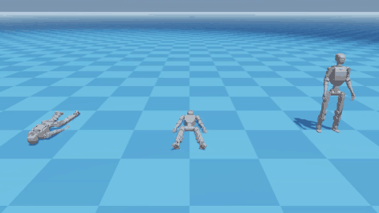
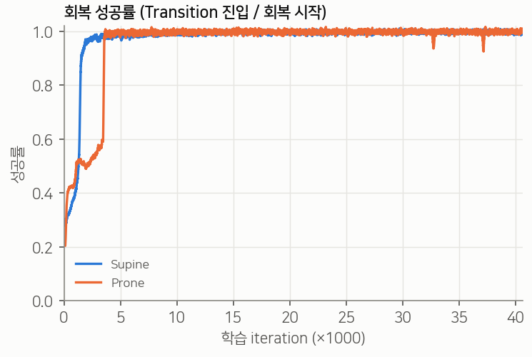
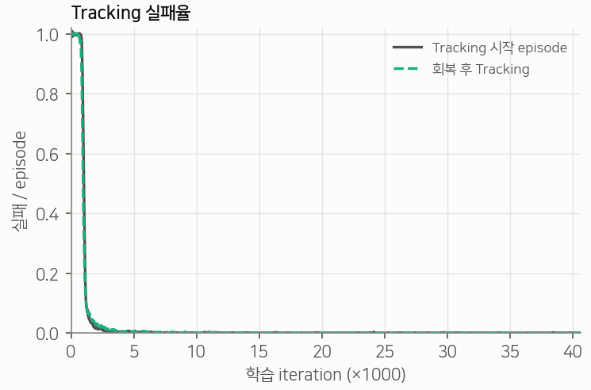
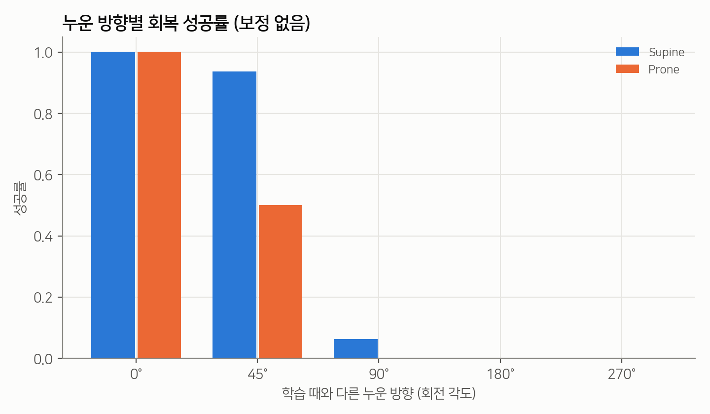

# TRACE: Tracking and Recovery Adaptive Control with Experts for the ROBOTIS K1 Humanoid

[English](README.md) | **한국어**

[](https://docs.isaacsim.omniverse.nvidia.com/6.0.0/index.html)
[](https://isaac-sim.github.io/IsaacLab/develop/index.html)
[](https://github.com/newton-physics/newton)
[](https://github.com/leggedrobotics/rsl_rl)
[](LICENSE)

<p align="center">
  
</p>

<p align="center"><b><a href="https://yester-h.github.io/TRACE/">▶ 브라우저에서 직접 해보기</a></b>: 정책이 내 기기에서 실시간으로 돌아갑니다(MuJoCo WebAssembly + ONNX).</p>

<p align="center"><i>정책 하나, 시작 상태 세 가지. 왼쪽은 엎드린 자세(Prone), 가운데는 누운 자세(Supine), 오른쪽은 선 자세에서 시작합니다.
필요하면 스스로 일어난 뒤 모두 같은 춤을 이어 갑니다.</i></p>

**TRACE**는 ROBOTIS **K1** 휴머노이드(23 자유도)를 위한 단일 강화학습 정책입니다. 이 정책은

1. 댄스 모션 레퍼런스를 **따라 춤을 추고**,
2. 넘어지면 누운 자세든 엎드린 자세든 **스스로 일어나며**,
3. 외부의 모드 전환 없이 **자연스럽게 춤으로 돌아갑니다**.

정책의 입력은 고유수용성 감각(proprioception)과 댄스 레퍼런스뿐입니다. Tracking expert와 Recovery expert 중
무엇을 쓸지는 학습된 gate가 정합니다. 전체 구조는 [StableMimic](#감사의-글)을 따랐고, 실패 기반 적응형 샘플러는
[BeyondMimic](#감사의-글)에서 가져왔습니다. 학습은 Isaac Lab의 **Newton** 물리 백엔드에서 진행했습니다.

---

## 목차

- [주요 특징](#주요-특징)
- [방법](#방법)
- [결과](#결과)
- [설치](#설치)
- [사용법](#사용법)
- [저장소 구조](#저장소-구조)
- [실험 이력](#실험-이력)
- [한계](#한계)
- [감사의 글](#감사의-글)

## 주요 특징

- **춤, 낙상, 기상을 정책 하나로.** Supine, Prone, 선 자세 어디서 시작해도 춤으로 이어집니다.
- **학습 정체 구간 없음.** Supine과 Prone 회복 성공률이 모두 약 4k iteration 안에 0.95에 도달합니다.
- **강건한 시작.** 시작 frame과 reset 노이즈를 바꾼 회복 시작 192회가 모두 성공합니다.
- **인터랙티브 전시 데모.** 관람객이 로봇을 밀거나 공을 던지면 로봇이 넘어졌다가 일어나 다시 춤을 춥니다.
- **브라우저에서 실행.** [인터랙티브 웹 데모](https://yester-h.github.io/TRACE/)에서 같은 정책이 MuJoCo WebAssembly로 돌아갑니다. 어느 방향으로 눕히거나 밀어도 스스로 일어나 춤을 이어 갑니다. [`web/`](web) 참고.
- **배포 시 방향 정렬.** 재학습 없이 push 회복을 15/44에서 45/45로 올립니다.

## 방법

<p align="center">
<pre>
                      ┌───────────────────────────── proprioception history (H=4) ──┐
                      │                                                              ▼
 dance reference ──►  │  Tracking expert  μ_T ──┐                         ┌──── Gate f_G ────┐
 (live command)       │                         ├──► w_T·μ_T + (1−w_T)·μ_R │   softmax → w_T  │
 + proprioception ──► │  Recovery expert  μ_R ──┘          ▲              └──────────────────┘
 (H=4, 508-dim)       └────────────────────────────────────┴──► joint position targets (23)
</pre>
</p>

| 구성 요소 | 역할 |
|---|---|
| **두 expert** | Tracking actor와 Recovery actor입니다. 각각 508→512→256→128→23 ELU MLP이고, Gaussian `log_std` 하나를 공유합니다. |
| **고유수용성 gate** | `w_T = softmax(f_G(H4(o_prop)) / τ)`로 두 expert의 평균 행동을 섞습니다. 입력은 각속도, 관절 위치·속도, 이전 행동, 중력 방향입니다. 학습 시 cross-entropy loss(Transition 구간 ×4), consistency loss, expert alignment loss를 더합니다. |
| **숨겨진 회복 레퍼런스** | actor는 기상 모션을 보지 않습니다. Supine·Prone 기상 레퍼런스는 숨겨진 다음 frame 목표를 통해 보상에만 쓰입니다. 그래서 Recovery expert 하나가 고유수용성 감각만으로 두 기상 동작을 배웁니다. |
| **Transition** | 75 step(1.5초) 동안 Tracking 보상에 α = 0 → 1을 곱합니다. 마지막 frame에서 직립했을 때, 25 step 연속 직립했을 때(조기 직립), 또는 춤을 다시 따라잡았을 때 시작합니다. |
| **적응형 reset 샘플러** | 20개 phase bin에 대해 균일 샘플링과 적응형 샘플링을 50:50으로 섞습니다. 실패가 나면 실패 지점 이전 최대 2초의 bin도 0.8^s 가중치로 함께 올립니다(BeyondMimic look-ahead). |
| **종료 조건** | 정규화된 오차가 4를 넘는 상태가 2초 지속되면 종료합니다. 마지막 frame에서는 1초 유예가 있습니다. Tracking은 낙상·이탈 기준을 씁니다. |
| **기상 레퍼런스 trim** | 움직임이 없는 앞부분을 잘랐습니다(Supine 100 frame, Prone 80 frame). 이제 두 기상 동작 모두 약 0.56초에 움직이기 시작합니다. |
| **PPO** | RSL-RL 5. observation normalization, scalar std, entropy 0.005, 환경 4096개, seed 42. |

observation 구성, 보상 커널, 샘플러, 로그 정의는
[`overlay/.../trace_recovery/README.md`](overlay/source/cyclo_lab/cyclo_lab/manager_based/trace_recovery/README.md)(영문)에 자세히 있습니다.

## 결과

최종 정책은 **run 23**(`Cyclo-TRACE-K1-Rev1-Integrated-Gated-ProneTrim`, iteration 40,600)입니다.
[`checkpoints/run23_gated_prone_trim/`](checkpoints/run23_gated_prone_trim)에 포함되어 있습니다.

| 지표 | Supine | Prone |
|---|---|---|
| 회복 성공률 (학습 종료 시점) | 0.997 | 0.999 |
| 성공률이 처음 0.95에 도달한 iteration | ~2.1k | ~4.0k |
| frame-0 결정론적 평가: Tracking 시작 step | 261 (5.2초) | 338 (6.8초) |
| 섭동을 준 고정 시작점 회복 (두 동작 합계) | 192 / 192 | |

<p align="center">
  
  
</p>

**Push 회복과 누운 방향.** Recovery expert는 학습 중 한 가지 누운 방향만 경험했습니다(reset yaw 노이즈 ±0.05 rad).
그래서 90° 이상 돌아간 채 쓰러지면 거의 일어나지 못합니다(아래 그림).
`trace_heading_alignment.py`는 로봇이 0.3초 동안 가만히 누워 있으면 댄스 레퍼런스를 z축으로 돌려
누운 방향에 맞춥니다. 이것만으로 8방향 × 3단계 push 테스트에서 춤으로 돌아온 낙상이
**15/44에서 45/45**로 늘었습니다.

<p align="center">
  
</p>

## 설치

TRACE는 [ROBOTIS cyclo_lab](https://github.com/ROBOTIS-GIT/cyclo_lab) Newton 브랜치의 애드온입니다.
테스트 환경은 다음과 같습니다.

| | 버전 |
|---|---|
| cyclo_lab | 브랜치 `k1/isaacsim-6-newton`, 커밋 `5bab742` |
| Isaac Sim / Isaac Lab | 6.0.0 / 3.0.0-beta2 (cyclo_lab submodule) |
| 물리 엔진 | Newton 1.2.1 + MuJoCo-Warp |
| GPU | RTX 4060 Laptop 8 GB (환경 4096개 학습 시 약 4.4 GB 사용) |

```bash
# 1. cyclo_lab (Newton 브랜치)과 Docker 환경
git clone --recursive -b k1/isaacsim-6-newton https://github.com/ROBOTIS-GIT/cyclo_lab.git
cd cyclo_lab && git checkout 5bab742 && cd ..
#    cyclo_lab README를 따라 컨테이너를 빌드하고 실행합니다

# 2. TRACE
git clone https://github.com/YESTER-H/TRACE.git
./TRACE/install.sh ./cyclo_lab
```

`install.sh`는 먼저 `scripts/reinforcement_learning/rsl_rl/{train,play}.py`에 작은 패치를 적용합니다.
패치는 진단 hook과 `--skip-export`, `--max-steps` 옵션을 추가합니다.
그다음 [`overlay/`](overlay)의 새 파일을 cyclo_lab에 복사하며, 기존 파일은 덮어쓰지 않습니다.
태스크는 `cyclo_lab`을 import할 때 자동으로 등록됩니다.

## 사용법

모든 명령은 cyclo_lab 컨테이너 안의 `/workspace/cyclo_lab`에서 실행합니다.

**학습** (최종 설정, scratch):

```bash
/isaac-sim/python.sh scripts/reinforcement_learning/rsl_rl/train.py \
    --task Cyclo-TRACE-K1-Rev1-Integrated-Gated-ProneTrim --headless \
    --num_envs 4096 --max_iterations 50000
```

**재생** (사전 학습 체크포인트):

```bash
CKPT=/path/to/TRACE/checkpoints/run23_gated_prone_trim/model_40600.pt
/isaac-sim/python.sh scripts/reinforcement_learning/rsl_rl/play.py \
    --task Cyclo-TRACE-K1-Rev1-Integrated-Gated-ProneTrim-Play \
    --num_envs 3 --checkpoint $CKPT --skip-export
```

**평가.** 각 스크립트는 `--output-dir`에 CSV와 JSON을 저장합니다.

```bash
TASK=Cyclo-TRACE-K1-Rev1-Integrated-Gated-ProneTrim-Play
# 선 자세 / Supine / Prone을 frame 0에서 나란히 시작 (위 GIF), reset 없음
/isaac-sim/python.sh scripts/reinforcement_learning/rsl_rl/evaluate_trace_integrated_three_views.py \
    --eval-task $TASK --loop --no-resets --output-dir logs/eval/three_views --checkpoint $CKPT
# (동작, 시작 frame)마다 섭동을 준 시작 32회
/isaac-sim/python.sh scripts/reinforcement_learning/rsl_rl/diagnose_trace_fixed_starts.py --headless \
    --eval-task $TASK --supine-frames 0,100,200 --prone-frames 0,100,200 \
    --output-dir logs/eval/fixed_starts --checkpoint $CKPT
# Transition과 후반 Tracking의 action-rate 부드러움 비교
/isaac-sim/python.sh scripts/reinforcement_learning/rsl_rl/diagnose_trace_transition_smoothness.py --headless \
    --eval-task $TASK --supine-frames 0 --prone-frames 0 --output-dir logs/eval/smoothness --checkpoint $CKPT
# 8방향 × 3단계 속도 push, 방향 정렬 사용
/isaac-sim/python.sh scripts/reinforcement_learning/rsl_rl/diagnose_trace_push_recovery.py --headless \
    --align-heading --output-dir logs/eval/push --checkpoint $CKPT
```

전체 옵션은 각 스크립트의 docstring(`--help`)에 있습니다.

**인터랙티브 전시.** 로봇 한 대가 춤을 추는 동안 직접 넘어뜨려 볼 수 있습니다.

```bash
/isaac-sim/python.sh scripts/reinforcement_learning/rsl_rl/exhibition_trace_push.py \
    --eval-task Cyclo-TRACE-K1-Rev1-Integrated-Gated-ProneTrim-Play \
    --output-dir logs/eval/exhibition_$(date +%H%M%S) --checkpoint $CKPT
```

| 키 | 동작 |
|---|---|
| `I` `K` `J` `L` / `P` | 화면 기준 뒤 / 앞 / 왼쪽 / 오른쪽 / 무작위 방향으로 밀기 |
| `1` `2` `3` | 세기: 약 / 중 / 강 |
| `B` | push 모드와 공 모드 전환 (0.45 kg, 3 kg, 10 kg 공을 몸통에 던짐) |
| 오른쪽 클릭 드래그 | 마우스로 몸체 잡아당기기 |
| `R` | 춤 시작 자세로 reset |
| `C` / `G` | 카메라 따라가기 / 방향 정렬 켜기·끄기 |

`--record`를 붙이면 3D 화면을 `session.mp4`로 저장합니다. 이벤트는 `events.csv`와 `summary.json`에 기록됩니다.

### 등록된 태스크

| 태스크 | 설명 |
|---|---|
| `Cyclo-TRACE-K1-Rev1-Integrated-Gated-ProneTrim` (`-Play`) | **최종**: gate, look-ahead 샘플러, Supine trim100, Prone trim80 |
| `Cyclo-TRACE-K1-Rev1-Integrated-Gated-Lookahead` | run 22: 최종 구조, Prone은 trim 전 레퍼런스 |
| `Cyclo-TRACE-K1-Rev1-Integrated-Gated` (`-Play`) | run 21: look-ahead 없는 학습된 gate |
| `Cyclo-TRACE-K1-Rev1-Integrated-U15` / `-U15-Balanced` (`-Play`) | oracle router (StableMimic U1.5 이식) |
| `Cyclo-TRACE-K1-Rev1-Recovery-Only` / `-Motion-Experts` / `-Paper-Aligned` (`-Play`) | Recovery만 학습하는 ablation |
| `Cyclo-TRACE-K1-Rev1-Recovery-Only-PhysX` | 같은 MDP를 PhysX 백엔드에서 비교 |

레퍼런스 모션은 `source/cyclo_lab/data/motions/K1_rev1/trace_inputs/`(`tracking.npz`, `supine.npz`, `prone.npz`)에서 읽습니다.
다른 파일을 쓰려면 `TRACE_MOTION_INPUT_DIR`을 지정하세요.

## 저장소 구조

```
TRACE/
├── install.sh                      # cyclo_lab에 패치 적용 + 파일 복사
├── patches/
│   └── rsl_rl_play_train.patch     # upstream train.py / play.py 수정분
├── overlay/                        # cyclo_lab 구조 그대로 배치한 새 파일
│   ├── source/cyclo_lab/cyclo_lab/manager_based/trace_recovery/
│   │   ├── commands.py             # Recovery 전용 command: 레퍼런스, 샘플러, 실패 판정
│   │   ├── integrated.py           # Tracking / Recovery / Transition 상태 기계
│   │   ├── gated.py                # 고유수용성 gate, look-ahead 샘플러, TracePPO loss
│   │   ├── policy.py               # 2-expert actor와 별도 critic
│   │   ├── env_cfg.py, runner_cfg.py, mdp.py, environment.py
│   │   ├── body_adapter.py         # 기존 25-body 배치 ↔ Newton 24-body 배치
│   │   └── physx_compat.py         # PhysX 백엔드 접촉 센서
│   ├── source/cyclo_lab/data/motions/K1_rev1/
│   │   ├── trace_inputs/           # Tracking(dance1), Supine·Prone 기상 레퍼런스
│   │   └── get_up/                 # trim한 기상 레퍼런스 (trim100 / trim80)
│   ├── source/cyclo_lab/test/      # actor와 로깅 단위 테스트
│   └── scripts/
│       ├── reinforcement_learning/rsl_rl/   # evaluate_*, diagnose_*, smoke_*, 전시
│       └── tools/motion/                    # trim_reference_motion.py, replay_npz_stepped.py
├── checkpoints/run23_gated_prone_trim/      # model_40600.pt + params/{agent,env}.yaml
├── web/                            # 브라우저 데모 (mjswan): sim2sim 검증, ONNX export, Pages 빌드
├── assets/                         # README용 GIF와 그래프
└── docs/experiments.md             # 전체 실험 이력 (23 run, 영문)
```

## 실험 이력

PhysX와 Newton에서 총 23번 학습한 끝에 지금의 구조에 도달했습니다. 요약하면 다음과 같습니다.

| 단계 | 변경 | 결과 |
|---|---|---|
| 단일 동작 | 춤, Supine, Prone을 각각 따로 학습 | 모두 학습됨 |
| 공유 actor / 3 expert | 세 동작을 한 정책으로, oracle 모드 전환 | 회복이 마지막 frame까지 가지만 일어서지 못함 |
| Tracking + 통합 Recovery (U1–U1.5) | 회복 레퍼런스 숨김, H4 history, 적응형 샘플링 | Prone이 ~0.5에서 정체 |
| Recovery만 분리 (Newton) | 회복 문제만 따로 학습 | Prone 실패의 99.6%가 frame 329–351(상체를 세우는 구간) |
| StableMimic 설정 | observation normalization, reset 섭동, 성공 보상 | Prone 0.999 |
| 통합 + 학습된 gate | oracle을 gate로 교체, Supine trim, 조기 직립 | 긴 무작위 정체 (Prone은 ~49k에 도약) |
| + 2초 실패 look-ahead | BeyondMimic 커널, 50:50 샘플링 | 둘 다 0.99, frame-0에서 회복 후 춤으로 복귀, 192/192 |
| **+ Prone trim (최종)** | 기상 시작 시점 맞춤 | **정체 없음, Prone이 3.4초 더 빨리 Tracking에 진입** |

각 단계의 세부 내용, 그래프, 판단 근거는 [docs/experiments.md](docs/experiments.md)(영문)에 있습니다.

## 한계

- **학습한 누운 방향이 하나뿐입니다.** 배포 시 방향 정렬로 보완했습니다. 근본적인 해결책은 Recovery reset에서 yaw를 무작위화하는 것입니다.
- **시뮬레이션에서만 검증했습니다.** sim-to-real은 시도하지 않았습니다. 입력이 두 개인 gated actor의 JIT/ONNX export는 구현되어 있지 않습니다.
- **춤이 하나뿐입니다.** Tracking 레퍼런스는 cyclo_lab의 6초짜리 `dance1` 클립입니다. 여러 춤을 오가려면 multi-motion Tracking 라이브러리가 필요합니다.
- **seed 하나로만 학습했습니다.** 모든 run은 seed 42로 한 번씩만 학습했습니다. 비슷한 설정에서도 정체가 풀리는 시점의 편차가 컸습니다.

## 감사의 글

- [**cyclo_lab**](https://github.com/ROBOTIS-GIT/cyclo_lab)(ROBOTIS): K1 로봇, mimic 태스크, Newton 환경을 제공했으며 이 작업의 기반입니다.
- [**Isaac Lab**](https://github.com/isaac-sim/IsaacLab), [**Newton**](https://github.com/newton-physics/newton), [**RSL-RL**](https://github.com/leggedrobotics/rsl_rl).
- **StableMimic**: expert, gate, transition 구조와 Table V 학습 설정을 참고했습니다.
- [**BeyondMimic**](https://beyondmimic.github.io/): 실패 look-ahead 커널을 쓰는 적응형 샘플링을 참고했습니다.
- 기상 레퍼런스는 **BONES-SEED** 모션 데이터셋을 [soma-retargeter](https://github.com/ROBOTIS-GIT/soma-retargeter)로 리타겟한 것입니다.

## 라이선스

Apache License 2.0입니다([LICENSE](LICENSE) 참고). 이 프로젝트에는 cyclo_lab(Apache-2.0)과
Isaac Lab(BSD-3-Clause)에서 파생된 코드가 포함되어 있습니다([NOTICE](NOTICE) 참고). 기상 모션 파일은
BONES-SEED에서 파생되었으며 해당 데이터셋의 이용 조건을 따릅니다.
