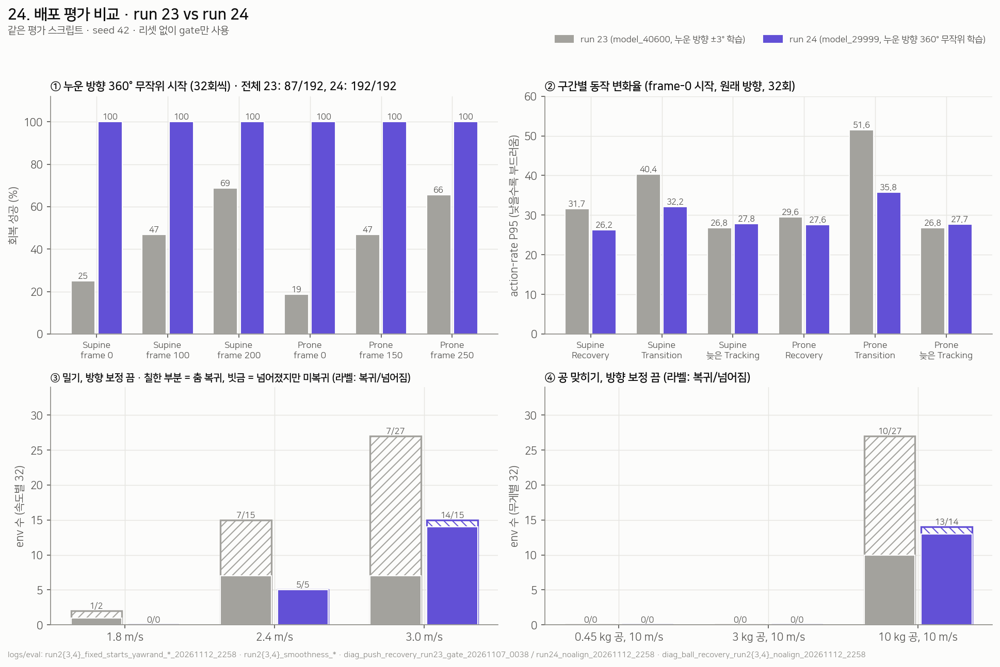
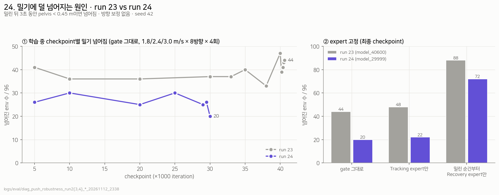
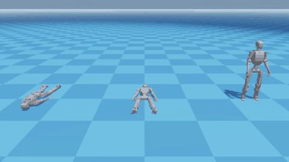
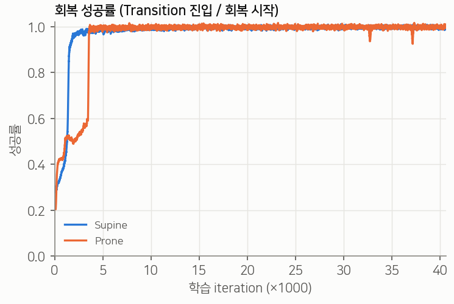
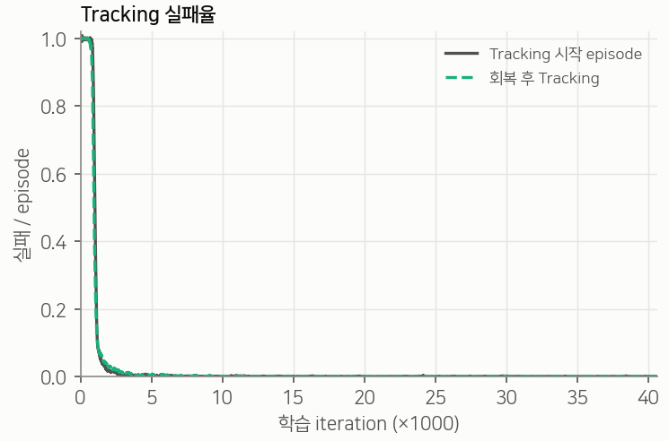

# TRACE: Tracking and Recovery via A Gated Composition of Experts for the ROBOTIS K1 Humanoid

**English** | [한국어](README.ko.md)

[](https://docs.isaacsim.omniverse.nvidia.com/6.0.0/index.html)
[](https://isaac-sim.github.io/IsaacLab/develop/index.html)
[](https://github.com/newton-physics/newton)
[](https://github.com/leggedrobotics/rsl_rl)
[](LICENSE)

<p align="center">
  
</p>

<p align="center"><b><a href="https://yester-h.github.io/TRACE/">▶ Try it in your browser</a></b>: the policy runs live on your device (MuJoCo WebAssembly + ONNX).</p>

<p align="center"><i>One policy (run 24), three starts, in CPU MuJoCo. Left: lying face down (Prone). Middle: lying face up (Supine). Right: standing.
Both lying robots start with their heads away from the camera. Supine sits up facing the dance and joins in. Prone stands up facing away, then turns around to rejoin the dance.</i></p>

**TRACE** (**T**racking and **R**ecovery via **A** gated **C**omposition of **E**xperts) is a single reinforcement-learning policy for the ROBOTIS **K1** humanoid (23 DoF) that

1. **tracks a dance** motion reference,
2. **gets up by itself** after it falls, either face up or face down, and
3. **goes back to the dance** smoothly, without any external mode switch.

The policy runs only on proprioception and the dance reference. A learned gate decides when to use the
Tracking expert and when to use the Recovery expert. The design follows
[StableMimic](#acknowledgements) and borrows the adaptive failure sampler from [BeyondMimic](#acknowledgements).
Training is done in Isaac Lab with the **Newton** physics backend.

---

## Contents

- [Highlights](#highlights)
- [Method](#method)
- [Results](#results)
- [Installation](#installation)
- [Usage](#usage)
- [Repository structure](#repository-structure)
- [Experiment history](#experiment-history)
- [Limitations](#limitations)
- [Acknowledgements](#acknowledgements)

## Highlights

- **One policy for dancing, falling and getting up.** Starts from Supine, Prone and standing all end in the dance.
- **No plateau in training.** Supine and Prone recovery both reach 0.95 success by about 4k iterations.
- **Gets up in any heading.** Run 24 randomizes the lying heading in training (yaw ±180°). Random-heading starts go from 87/192 (run 23) to **192/192**, with no deployment-time correction.
- **Harder to knock over.** In the same push test, run 24 falls 20 times where run 23 falls 44 times, and 19 of the 20 come back to the dance.
- **Interactive exhibition demo.** Visitors push the robot or throw balls at it. It falls, gets up and keeps dancing.
- **Runs in the browser.** An [interactive web demo](https://yester-h.github.io/TRACE/) runs run 24 in MuJoCo WebAssembly. Knock it down or shove it from any direction, and it gets up and dances on. See [`web/`](web).
- **Checked outside the training simulator.** Run 23 passes a 37-condition MuJoCo sim-to-sim sweep (solver, friction, mass, gains, delay ≤ 20 ms). See [`sim2sim/`](sim2sim).

## Method

<p align="center">
<pre>
                      ┌───────────────────────────── proprioception history (H=4) ──┐
                      │                                                              ▼
 dance reference ──►  │  Tracking expert  μ_T ──┐                         ┌──── Gate f_G ────┐
 (live command)       │                         ├──► w_T·μ_T + (1−w_T)·μ_R │   softmax → w_T  │
 + proprioception ──► │  Recovery expert  μ_R ──┘          ▲              └──────────────────┘
 (H=4, 508-dim)       └────────────────────────────────────┴──► joint position targets (23)
</pre>
</p>

| Component | What it does |
|---|---|
| **Two experts** | Tracking and Recovery actors, each a 508→512→256→128→23 ELU MLP, with one shared Gaussian `log_std`. |
| **Proprioceptive gate** | `w_T = softmax(f_G(H4(o_prop)) / τ)` blends the two expert means. Its inputs are angular velocity, joint position and velocity, previous action and gravity. Training adds a cross-entropy loss (×4 during Transition), a consistency loss and an expert-alignment loss. |
| **Hidden recovery references** | The actor never sees the get-up motion. Supine and Prone get-up references only shape the reward through the hidden next-frame target. So one Recovery expert learns both get-ups from proprioception. |
| **Transition** | A 75-step (1.5 s) phase scales the Tracking reward by α = 0 → 1. It starts after an upright final frame, after 25 upright steps (early upright), or after re-acquiring the dance. |
| **Adaptive reset sampler** | Uniform and adaptive sampling are mixed 50:50 over 20 phase bins. Failures also raise the bins up to 2 s before the failure, with weight 0.8^s (the BeyondMimic look-ahead). |
| **Termination** | A persistent-error rule ends the episode when the normalized error stays > 4 for 2 s. A 1 s grace period applies at the final frame. Tracking uses fall and deviation limits. |
| **Trimmed get-up references** | The still lead-ins are removed: 100 frames from Supine and 80 frames from Prone. Both get-ups now start moving at about 0.56 s. |
| **Heading randomization** (run 24) | Recovery resets turn the get-up reference and the robot by a yaw drawn from [−π, π). The dance reference is not turned, so after standing up the robot must turn to the dance heading itself. |
| **PPO** | RSL-RL 5. Observations are normalized, std is scalar, entropy is 0.005. 4096 environments, seed 42. |

See [`overlay/.../trace_recovery/README.md`](overlay/source/cyclo_lab/cyclo_lab/manager_based/trace_recovery/README.md)
for the exact observation layout, reward kernels, sampler and logging definitions.

## Results

The final policy is **run 24**, `Cyclo-TRACE-K1-Rev1-Integrated-Gated-ProneTrim-YawRand`, at iteration 29,999
([`checkpoints/run24_gated_prone_trim_yawrand/`](checkpoints/run24_gated_prone_trim_yawrand)).
It is run 23 ([`checkpoints/run23_gated_prone_trim/`](checkpoints/run23_gated_prone_trim), iteration 40,600)
plus heading randomization of the Recovery resets. Everything else is the same.

| Metric | Run 23 | **Run 24** |
|---|---|---|
| Recovery success at the end of training (Supine / Prone) | 0.997 / 0.999 | 0.997 / 0.998 |
| Iteration where success first reaches 0.95 (Supine / Prone) | ~2.1k / ~4.0k | ~1.3k / ~3.6k |
| Frame-0 eval: step where Tracking starts (Supine / Prone) | 261 / 338 | 261 / 328 |
| Perturbed fixed starts, trained heading | 192 / 192 | 192 / 192 |
| Perturbed fixed starts, **random lying heading** | 87 / 192 | **192 / 192** |
| Transition action-rate P95 (Supine / Prone; lower is smoother) | 40.4 / 51.6 | 32.2 / 35.8 |
| Push test without alignment (falls → back to the dance) | 44 → 15 | **20 → 19** |
| 10 kg ball at 10 m/s, without alignment (falls → back) | 27 → 10 | 14 → 13 |

<p align="center">
  
</p>

**Why heading randomization helps twice.** Run 23 saw only one lying heading in training (reset yaw noise
±0.05 rad). A robot that lands rotated by 90° or more almost never gets up, so the exhibition script needed a
deployment-time fix: once the robot lies still, it turns the dance reference to the robot's heading
(`trace_heading_alignment.py`, 15/44 → 45/45 in the push test). Run 24 learns this instead. It also falls less
often (left below, at every checkpoint from 5k on). Forcing the Tracking expert alone gives the same gap
(48 vs 22 falls), so the extra robustness lives in the Tracking expert. A likely reason, not verified, is that
run 24's Tracking starts after standing up with a heading error of up to 180°, which acts as perturbation
training.

<p align="center">
  
</p>

<details>
<summary>Run 23: Isaac Lab / Newton footage, training curves and heading sensitivity</summary>
<p align="center">
  
</p>
<p align="center">
  
  
</p>
<p align="center">
  
</p>
</details>

## Installation

TRACE is an add-on to [ROBOTIS cyclo_lab](https://github.com/ROBOTIS-GIT/cyclo_lab), on its Newton branch.
It was tested on:

| | Version |
|---|---|
| cyclo_lab | branch `k1/isaacsim-6-newton`, commit `5bab742` |
| Isaac Sim / Isaac Lab | 6.0.0 / 3.0.0-beta2 (cyclo_lab submodule) |
| Physics | Newton 1.2.1 + MuJoCo-Warp |
| GPU | RTX 4060 Laptop, 8 GB (training uses ~4.4 GB at 4096 envs) |

```bash
# 1. cyclo_lab (Newton branch) and its Docker environment
git clone --recursive -b k1/isaacsim-6-newton https://github.com/ROBOTIS-GIT/cyclo_lab.git
cd cyclo_lab && git checkout 5bab742 && cd ..
#    follow cyclo_lab's README to build and start the container

# 2. TRACE
git clone https://github.com/YESTER-H/TRACE.git
./TRACE/install.sh ./cyclo_lab
```

`install.sh` applies a small patch to `scripts/reinforcement_learning/rsl_rl/{train,play}.py`.
The patch adds diagnostics hooks, `--skip-export` and `--max-steps`.
It then copies the new files from [`overlay/`](overlay) into cyclo_lab and never overwrites an existing file.
The tasks register themselves when `cyclo_lab` is imported.

## Usage

Run everything inside the cyclo_lab container, from `/workspace/cyclo_lab`.

**Train** the final configuration (run 24) from scratch:

```bash
/isaac-sim/python.sh scripts/reinforcement_learning/rsl_rl/train.py \
    --task Cyclo-TRACE-K1-Rev1-Integrated-Gated-ProneTrim-YawRand --headless \
    --num_envs 4096 --seed 42 --max_iterations 30000
```

Pass `--num_envs 4096` explicitly: the task default is 64. A correct run takes about 2.7 s per iteration on an
RTX 4060 Laptop (30k iterations ≈ 23 h).

**Play** the pretrained checkpoint:

```bash
CKPT=/path/to/TRACE/checkpoints/run24_gated_prone_trim_yawrand/model_29999.pt
/isaac-sim/python.sh scripts/reinforcement_learning/rsl_rl/play.py \
    --task Cyclo-TRACE-K1-Rev1-Integrated-Gated-ProneTrim-YawRand-Play \
    --num_envs 3 --checkpoint $CKPT --skip-export
```

**Evaluate.** Use these scripts; each one writes CSV and JSON to `--output-dir`:

```bash
TASK=Cyclo-TRACE-K1-Rev1-Integrated-Gated-ProneTrim-YawRand-Play
# Standing / Supine / Prone from frame 0, side by side (the teaser above), no resets
/isaac-sim/python.sh scripts/reinforcement_learning/rsl_rl/evaluate_trace_integrated_three_views.py \
    --eval-task $TASK --loop --no-resets --output-dir logs/eval/three_views --checkpoint $CKPT
# 32 perturbed starts per (motion, start frame)
/isaac-sim/python.sh scripts/reinforcement_learning/rsl_rl/diagnose_trace_fixed_starts.py --headless \
    --eval-task $TASK --supine-frames 0,100,200 --prone-frames 0,100,200 \
    --output-dir logs/eval/fixed_starts --checkpoint $CKPT
# Action-rate smoothness of Transition vs. late Tracking
/isaac-sim/python.sh scripts/reinforcement_learning/rsl_rl/diagnose_trace_transition_smoothness.py --headless \
    --eval-task $TASK --supine-frames 0 --prone-frames 0 --output-dir logs/eval/smoothness --checkpoint $CKPT
# Pushes in 8 directions x 3 speeds (add --align-heading for run 23)
/isaac-sim/python.sh scripts/reinforcement_learning/rsl_rl/diagnose_trace_push_recovery.py --headless \
    --eval-task $TASK --output-dir logs/eval/push --checkpoint $CKPT
# Push falls per checkpoint, and with the Tracking or Recovery expert forced
/isaac-sim/python.sh scripts/reinforcement_learning/rsl_rl/diagnose_trace_push_robustness.py --headless \
    --eval-task $TASK --gate native --output-dir logs/eval/push_robustness --checkpoint $CKPT
# Balls (0.45 / 3 / 10 kg at 10 m/s) thrown at the torso
/isaac-sim/python.sh scripts/reinforcement_learning/rsl_rl/diagnose_trace_ball_recovery.py --headless \
    --eval-task $TASK --output-dir logs/eval/balls --checkpoint $CKPT
```

Each script lists its full options in its docstring (`--help`).

**Interactive exhibition.** One robot dances while you knock it over:

```bash
/isaac-sim/python.sh scripts/reinforcement_learning/rsl_rl/exhibition_trace_push.py \
    --eval-task Cyclo-TRACE-K1-Rev1-Integrated-Gated-ProneTrim-YawRand-Play \
    --output-dir logs/eval/exhibition_$(date +%H%M%S) --checkpoint $CKPT
```

| Key | Action |
|---|---|
| `I` `K` `J` `L` / `P` | push away / toward / left / right / random direction |
| `1` `2` `3` | strength: light / medium / strong |
| `B` | switch between ball mode (the default; 0.45 kg, 3 kg or 10 kg ball thrown at the torso) and push mode |
| right-click drag | pull a body with the mouse |
| `R` | reset to the dance start |
| `C` / `G` | camera follow / heading alignment on or off (off by default; turn it on for run 23) |

Add `--record` to save the 3D view to `session.mp4`. Events go to `events.csv` and `summary.json`.

### Registered tasks

| Task | Description |
|---|---|
| `Cyclo-TRACE-K1-Rev1-Integrated-Gated-ProneTrim-YawRand` (`-Play`) | **Final (run 24)**: run 23 + Recovery reset yaw uniform in [−π, π) |
| `Cyclo-TRACE-K1-Rev1-Integrated-Gated-ProneTrim` (`-Play`) | Run 23: gate, look-ahead sampler, Supine trim100 and Prone trim80 |
| `Cyclo-TRACE-K1-Rev1-Integrated-Gated-Lookahead` | Run 22: final structure with the untrimmed Prone reference |
| `Cyclo-TRACE-K1-Rev1-Integrated-Gated` (`-Play`) | Run 21: learned gate without look-ahead |
| `Cyclo-TRACE-K1-Rev1-Integrated-U15` / `-U15-Balanced` (`-Play`) | Oracle router (StableMimic U1.5 port) |
| `Cyclo-TRACE-K1-Rev1-Recovery-Only` / `-Motion-Experts` / `-Paper-Aligned` (`-Play`) | Recovery-only ablations |
| `Cyclo-TRACE-K1-Rev1-Recovery-Only-PhysX` | Same MDP on the PhysX backend, for comparison |

Reference motions are read from `source/cyclo_lab/data/motions/K1_rev1/trace_inputs/`
(`tracking.npz`, `supine.npz`, `prone.npz`). Set `TRACE_MOTION_INPUT_DIR` to use other files.

## Repository structure

```
TRACE/
├── install.sh                      # patch + copy into a cyclo_lab checkout
├── patches/
│   └── rsl_rl_play_train.patch     # changes to upstream train.py / play.py
├── overlay/                        # new files, laid out like the cyclo_lab tree
│   ├── source/cyclo_lab/cyclo_lab/manager_based/trace_recovery/
│   │   ├── commands.py             # Recovery-only command: references, sampler, failures
│   │   ├── integrated.py           # Tracking / Recovery / Transition state machine
│   │   ├── gated.py                # proprioceptive gate, look-ahead sampler, TracePPO losses
│   │   ├── policy.py               # two-expert actor and separate critic
│   │   ├── env_cfg.py, runner_cfg.py, mdp.py, environment.py
│   │   ├── body_adapter.py         # legacy 25-body layout ↔ native Newton 24-body layout
│   │   └── physx_compat.py         # PhysX backend contact sensors
│   ├── source/cyclo_lab/data/motions/K1_rev1/
│   │   ├── trace_inputs/           # tracking (dance1), Supine and Prone get-up references
│   │   └── get_up/                 # trimmed get-up references (trim100 / trim80)
│   ├── source/cyclo_lab/test/      # unit tests for the actors and logging
│   └── scripts/
│       ├── reinforcement_learning/rsl_rl/   # evaluate_*, diagnose_*, smoke_*, exhibition
│       └── tools/motion/                    # trim_reference_motion.py, replay_npz_stepped.py
├── checkpoints/
│   ├── run24_gated_prone_trim_yawrand/      # final: model_29999.pt + params/{agent,env}.yaml
│   └── run23_gated_prone_trim/              # model_40600.pt + params
├── web/                            # browser demo (mjswan): MuJoCo port, ONNX export, Pages build
├── sim2sim/                        # native MuJoCo viewer and the strict sim-to-sim sweep
├── assets/                         # GIFs and figures for this README (teaser: web/make_teaser.py)
└── docs/experiments.md             # the full run history (24 runs)
```

## Experiment history

Getting here took 24 training runs on PhysX and Newton. The short version:

| Stage | Change | Outcome |
|---|---|---|
| Single skills | Dance, Supine and Prone, each trained alone | All learnable |
| Shared actor / 3 experts | One policy for all three, oracle mode switch | Recovery reaches the last frame but never stands |
| Tracking + unified Recovery (U1–U1.5) | Hidden recovery reference, H4 history, adaptive sampling | Prone stuck at ~0.5 |
| Recovery only (Newton) | Isolate the recovery problem | 99.6 % of Prone failures sit at frames 329–351 (torso lift) |
| StableMimic settings | Observation normalization, reset perturbation, success bonus | Prone 0.999 |
| Integrated + learned gate | Gate replaces oracle; Supine trim; early upright | Long random plateaus (Prone jump at ~49k) |
| + 2 s failure look-ahead | BeyondMimic kernel; 50:50 sampling | Both 0.99; frame-0 recover → dance; 192/192 |
| + Prone trim (run 23) | Matched get-up onset | No plateau; Prone reaches Tracking 3.4 s earlier |
| **+ Heading randomization (run 24, final)** | Recovery reset yaw ±180° | **Any lying heading 192/192; fewer push falls (44 → 20)** |

Details, figures and the reasoning behind each step are in [docs/experiments.md](docs/experiments.md).

## Limitations

- **Simulation only.** No sim-to-real transfer was attempted. The MuJoCo sweep points to actuation latency as the main risk: run 23 holds up to 20 ms of delay but not 40 ms. Training randomized no friction, mass, gains or latency. JIT/ONNX export from Isaac Lab of the two-input gated actor is not implemented; the web demo exports its own single-input graph.
- **One dance.** The Tracking reference is the 6 s `dance1` clip from cyclo_lab. A multi-motion Tracking library would be needed to switch between dances.
- **One seed.** Every run used seed 42 once. The iteration at which a plateau breaks varied a lot between similar runs.

## Acknowledgements

- [**cyclo_lab**](https://github.com/ROBOTIS-GIT/cyclo_lab) (ROBOTIS) provides the K1 robot, the mimic tasks and the Newton setup this work builds on.
- [**Isaac Lab**](https://github.com/isaac-sim/IsaacLab), [**Newton**](https://github.com/newton-physics/newton) and [**RSL-RL**](https://github.com/leggedrobotics/rsl_rl).
- **StableMimic** gave the expert, gate and transition structure and the Table V training settings.
- [**BeyondMimic**](https://beyondmimic.github.io/) gave the adaptive sampling with a failure look-ahead kernel.
- The get-up references were retargeted from the **BONES-SEED** motion dataset with [soma-retargeter](https://github.com/ROBOTIS-GIT/soma-retargeter).

## License

Apache License 2.0; see [LICENSE](LICENSE). This project contains code derived from cyclo_lab (Apache-2.0)
and Isaac Lab (BSD-3-Clause); see [NOTICE](NOTICE). The get-up motion files are derived from BONES-SEED
and follow that dataset's terms.
