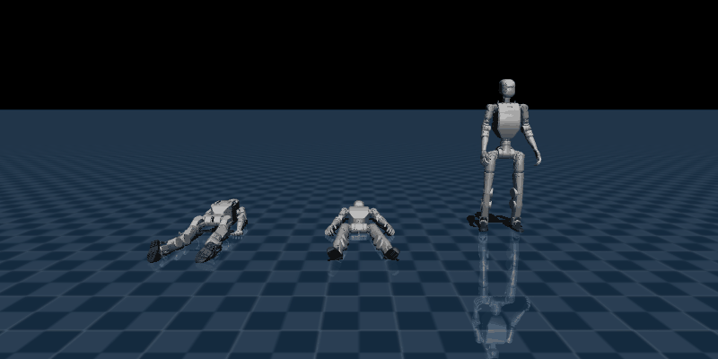

# TRACE: Tracking and Recovery via A Gated Composition of Experts

**English** | [한국어](README.ko.md)

[](https://docs.isaacsim.omniverse.nvidia.com/6.0.0/index.html)
[](https://isaac-sim.github.io/IsaacLab/develop/index.html)
[](https://github.com/newton-physics/newton)
[](LICENSE)

**[Project page and interactive demo](https://yester-h.github.io/TRACE/)**



A single RL policy for the ROBOTIS K1 humanoid. It tracks a dance, gets up after falling face up or face down
in any heading, and goes back to the dance. It is an add-on to
[cyclo_lab](https://github.com/ROBOTIS-GIT/cyclo_lab) (Isaac Lab, Newton backend).

## Tasks

| Task ID | Description |
| --- | --- |
| `Cyclo-TRACE-K1-Rev1-Integrated-Gated-ProneTrim-YawRand` | Training (final policy) |
| `Cyclo-TRACE-K1-Rev1-Integrated-Gated-ProneTrim-YawRand-Play` | Evaluation and playback |

The other `Cyclo-TRACE-*` tasks registered in
[`trace_recovery/__init__.py`](overlay/source/cyclo_lab/cyclo_lab/manager_based/trace_recovery/__init__.py)
are earlier variants.

## 0. Prerequisites

Set up [cyclo_lab](https://github.com/ROBOTIS-GIT/cyclo_lab) on its Newton branch, at the tested commit, and
build its Docker container by following its README.

```bash
git clone --recursive -b k1/isaacsim-6-newton https://github.com/ROBOTIS-GIT/cyclo_lab.git
cd cyclo_lab && git checkout 5bab742
```

Tested with Isaac Sim 6.0.0, Isaac Lab 3.0.0-beta2, Newton 1.2.1 and an RTX 4060 Laptop GPU (8 GB).

## 1. Installation

```bash
git clone https://github.com/YESTER-H/TRACE.git
./TRACE/install.sh /path/to/cyclo_lab
```

`install.sh` applies a small patch to cyclo_lab's `train.py` / `play.py`. It then copies the files in
[`overlay/`](overlay) into cyclo_lab and never overwrites an existing file. The tasks register when
`cyclo_lab` is imported.

## 2. Usage

Run inside the cyclo_lab container, from `/workspace/cyclo_lab`.

### Training

```bash
/isaac-sim/python.sh scripts/reinforcement_learning/rsl_rl/train.py \
    --task Cyclo-TRACE-K1-Rev1-Integrated-Gated-ProneTrim-YawRand --headless \
    --num_envs 4096 --seed 42 --max_iterations 30000
```

Pass `--num_envs 4096`; the task default is 64. Expect about 2.7 s per iteration on an RTX 4060 Laptop GPU.

### Playback

```bash
CKPT=/path/to/TRACE/checkpoints/run24_gated_prone_trim_yawrand/model_29999.pt
/isaac-sim/python.sh scripts/reinforcement_learning/rsl_rl/play.py \
    --task Cyclo-TRACE-K1-Rev1-Integrated-Gated-ProneTrim-YawRand-Play \
    --num_envs 3 --checkpoint $CKPT --skip-export
```

### Evaluation

```bash
TASK=Cyclo-TRACE-K1-Rev1-Integrated-Gated-ProneTrim-YawRand-Play
# Stand / Supine / Prone from frame 0, side by side
/isaac-sim/python.sh scripts/reinforcement_learning/rsl_rl/evaluate_trace_integrated_three_views.py \
    --eval-task $TASK --loop --no-resets --output-dir logs/eval/three_views --checkpoint $CKPT
# Recovery from fixed start frames, 32 perturbed starts each
/isaac-sim/python.sh scripts/reinforcement_learning/rsl_rl/diagnose_trace_fixed_starts.py --headless \
    --eval-task $TASK --supine-frames 0,100,200 --prone-frames 0,100,200 \
    --output-dir logs/eval/fixed_starts --checkpoint $CKPT
# Pushes in 8 directions x 3 speeds
/isaac-sim/python.sh scripts/reinforcement_learning/rsl_rl/diagnose_trace_push_recovery.py --headless \
    --eval-task $TASK --output-dir logs/eval/push --checkpoint $CKPT
```

Each script writes CSV and JSON to `--output-dir`. Options are listed with `--help`.

### Interactive exhibition

One robot dances while you throw balls at it or push it.

```bash
/isaac-sim/python.sh scripts/reinforcement_learning/rsl_rl/exhibition_trace_push.py \
    --eval-task Cyclo-TRACE-K1-Rev1-Integrated-Gated-ProneTrim-YawRand-Play \
    --output-dir logs/eval/exhibition_$(date +%H%M%S) --checkpoint $CKPT
```

| Key | Action |
| --- | --- |
| `I` `K` `J` `L` / `P` | away / toward / left / right / random direction |
| `1` `2` `3` | strength |
| `B` | ball mode (default) ↔ push mode |
| `R` | reset to the dance start |
| `C` | camera follow on/off |

### MuJoCo and browser

The policy also runs in plain MuJoCo without Isaac Sim:
- [`sim2sim/`](sim2sim): native viewer and sim-to-sim tests.
- [`web/`](web): the browser demo build.

## Code structure

- **`overlay/source/cyclo_lab/cyclo_lab/manager_based/trace_recovery/`**: the TRACE tasks.
  - `commands.py`, `integrated.py`, `gated.py`: reference motions, reset sampling, Tracking/Recovery/Transition logic, and the gate losses.
  - `policy.py`: the Tracking/Recovery expert actor.
  - `env_cfg.py`, `runner_cfg.py`: environment and PPO configs.
- **`overlay/source/cyclo_lab/data/motions/K1_rev1/`**: the dance and get-up reference motions.
- **`overlay/scripts/reinforcement_learning/rsl_rl/`**: evaluation, diagnostics and exhibition scripts.
- **`patches/`**: the patch applied to cyclo_lab's `train.py` / `play.py`.
- **`checkpoints/`**: pretrained policies. The final one is `run24_gated_prone_trim_yawrand`; `run23_gated_prone_trim` was trained without heading randomization.

## License

Apache License 2.0. Code derived from cyclo_lab and Isaac Lab is noted in [LICENSE](LICENSE) and
[NOTICE](NOTICE). The get-up motions are retargeted from the BONES-SEED dataset and follow its terms.
