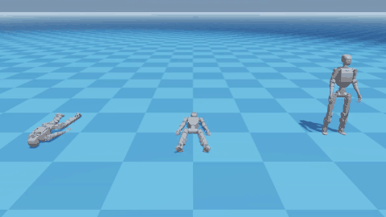
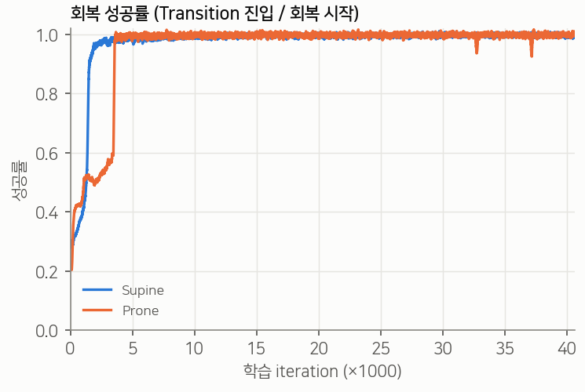
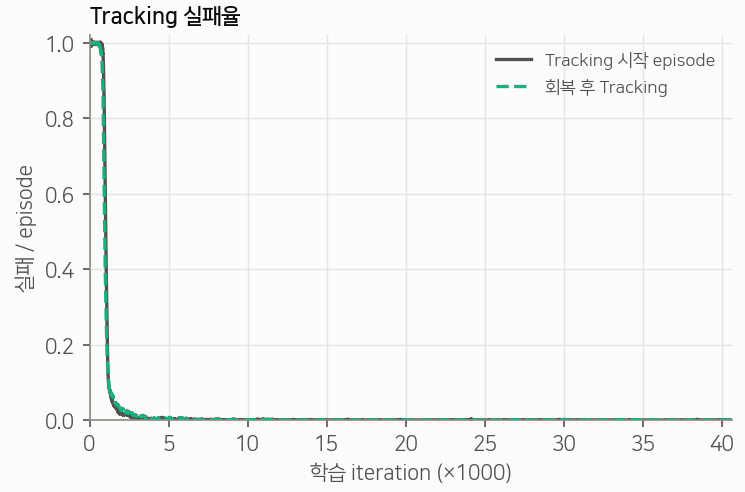
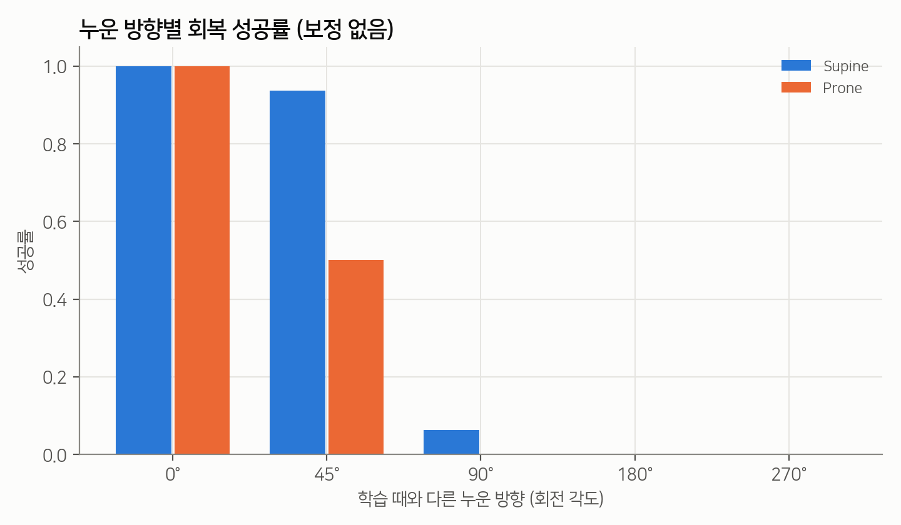

# TRACE: Tracking and Recovery Adaptive Control with Experts for the ROBOTIS K1 Humanoid

**English** | [한국어](README.ko.md)

[](https://docs.isaacsim.omniverse.nvidia.com/6.0.0/index.html)
[](https://isaac-sim.github.io/IsaacLab/develop/index.html)
[](https://github.com/newton-physics/newton)
[](https://github.com/leggedrobotics/rsl_rl)
[](LICENSE)

<p align="center">
  
</p>

<p align="center"><b><a href="https://yester-h.github.io/TRACE/">▶ Try it in your browser</a></b>: the policy runs live on your device (MuJoCo WebAssembly + ONNX).</p>

<p align="center"><i>One policy, three starts. Left: lying face down (Prone). Middle: lying face up (Supine). Right: standing.
All three get up when needed and then follow the same dance.</i></p>

**TRACE** is a single reinforcement-learning policy for the ROBOTIS **K1** humanoid (23 DoF) that

1. **tracks a dance** motion reference,
2. **gets up by itself** after it falls, either face up or face down, and
3. **goes back to the dance** smoothly, without any external mode switch.

The policy runs only on proprioception and the dance reference. A learned gate decides when to use the
Tracking expert and when to use the Recovery expert. The design follows
[StableMimic](#acknowledgements) and borrows the adaptive failure sampler from [BeyondMimic](#acknowledgements).
Training is done in Isaac Lab with the **Newton** physics backend.

---

## Contents

- [Highlights](#highlights)
- [Method](#method)
- [Results](#results)
- [Installation](#installation)
- [Usage](#usage)
- [Repository structure](#repository-structure)
- [Experiment history](#experiment-history)
- [Limitations](#limitations)
- [Acknowledgements](#acknowledgements)

## Highlights

- **One policy for dancing, falling and getting up.** Starts from Supine, Prone and standing all end in the dance.
- **No plateau in training.** Supine and Prone recovery both reach 0.95 success by about 4k iterations.
- **Robust starts.** 192 of 192 perturbed recovery starts succeed, at different frames and with reset noise.
- **Interactive exhibition demo.** Visitors push the robot or throw balls at it. It falls, gets up and keeps dancing.
- **Runs in the browser.** An [interactive web demo](https://yester-h.github.io/TRACE/) runs the same policy in MuJoCo WebAssembly. Knock it down or shove it from any direction, and it gets up and dances on. See [`web/`](web).
- **Heading alignment at deployment.** No retraining is needed. It raises push recovery from 15/44 to 45/45.

## Method

<p align="center">
<pre>
                      ┌───────────────────────────── proprioception history (H=4) ──┐
                      │                                                              ▼
 dance reference ──►  │  Tracking expert  μ_T ──┐                         ┌──── Gate f_G ────┐
 (live command)       │                         ├──► w_T·μ_T + (1−w_T)·μ_R │   softmax → w_T  │
 + proprioception ──► │  Recovery expert  μ_R ──┘          ▲              └──────────────────┘
 (H=4, 508-dim)       └────────────────────────────────────┴──► joint position targets (23)
</pre>
</p>

| Component | What it does |
|---|---|
| **Two experts** | Tracking and Recovery actors, each a 508→512→256→128→23 ELU MLP, with one shared Gaussian `log_std`. |
| **Proprioceptive gate** | `w_T = softmax(f_G(H4(o_prop)) / τ)` blends the two expert means. Its inputs are angular velocity, joint position and velocity, previous action and gravity. Training adds a cross-entropy loss (×4 during Transition), a consistency loss and an expert-alignment loss. |
| **Hidden recovery references** | The actor never sees the get-up motion. Supine and Prone get-up references only shape the reward through the hidden next-frame target. So one Recovery expert learns both get-ups from proprioception. |
| **Transition** | A 75-step (1.5 s) phase scales the Tracking reward by α = 0 → 1. It starts after an upright final frame, after 25 upright steps (early upright), or after re-acquiring the dance. |
| **Adaptive reset sampler** | Uniform and adaptive sampling are mixed 50:50 over 20 phase bins. Failures also raise the bins up to 2 s before the failure, with weight 0.8^s (the BeyondMimic look-ahead). |
| **Termination** | A persistent-error rule ends the episode when the normalized error stays > 4 for 2 s. A 1 s grace period applies at the final frame. Tracking uses fall and deviation limits. |
| **Trimmed get-up references** | The still lead-ins are removed: 100 frames from Supine and 80 frames from Prone. Both get-ups now start moving at about 0.56 s. |
| **PPO** | RSL-RL 5. Observations are normalized, std is scalar, entropy is 0.005. 4096 environments, seed 42. |

See [`overlay/.../trace_recovery/README.md`](overlay/source/cyclo_lab/cyclo_lab/manager_based/trace_recovery/README.md)
for the exact observation layout, reward kernels, sampler and logging definitions.

## Results

The final policy is **run 23**, `Cyclo-TRACE-K1-Rev1-Integrated-Gated-ProneTrim`, at iteration 40,600.
It is included in [`checkpoints/run23_gated_prone_trim/`](checkpoints/run23_gated_prone_trim).

| Metric | Supine | Prone |
|---|---|---|
| Recovery success (training, end) | 0.997 | 0.999 |
| Iteration where success first reaches 0.95 | ~2.1k | ~4.0k |
| Frame-0 deterministic eval: step where Tracking starts | 261 (5.2 s) | 338 (6.8 s) |
| Perturbed fixed starts recovered (both motions) | 192 / 192 | |

<p align="center">
  
  
</p>

**Push recovery and heading.** The Recovery expert saw only one lying heading in training (reset yaw noise ±0.05 rad).
A robot that lands rotated by 90° or more almost never gets up (left figure below).
`trace_heading_alignment.py` waits until the robot lies still for 0.3 s. It then rotates the dance reference
about z to match the lying heading. With this, push tests over 8 directions and 3 strengths go from
**15/44 to 45/45** falls recovered back into the dance.

<p align="center">
  
</p>

## Installation

TRACE is an add-on to [ROBOTIS cyclo_lab](https://github.com/ROBOTIS-GIT/cyclo_lab), on its Newton branch.
It was tested on:

| | Version |
|---|---|
| cyclo_lab | branch `k1/isaacsim-6-newton`, commit `5bab742` |
| Isaac Sim / Isaac Lab | 6.0.0 / 3.0.0-beta2 (cyclo_lab submodule) |
| Physics | Newton 1.2.1 + MuJoCo-Warp |
| GPU | RTX 4060 Laptop, 8 GB (training uses ~4.4 GB at 4096 envs) |

```bash
# 1. cyclo_lab (Newton branch) and its Docker environment
git clone --recursive -b k1/isaacsim-6-newton https://github.com/ROBOTIS-GIT/cyclo_lab.git
cd cyclo_lab && git checkout 5bab742 && cd ..
#    follow cyclo_lab's README to build and start the container

# 2. TRACE
git clone https://github.com/YESTER-H/TRACE.git
./TRACE/install.sh ./cyclo_lab
```

`install.sh` applies a small patch to `scripts/reinforcement_learning/rsl_rl/{train,play}.py`.
The patch adds diagnostics hooks, `--skip-export` and `--max-steps`.
It then copies the new files from [`overlay/`](overlay) into cyclo_lab and never overwrites an existing file.
The tasks register themselves when `cyclo_lab` is imported.

## Usage

Run everything inside the cyclo_lab container, from `/workspace/cyclo_lab`.

**Train** the final configuration from scratch:

```bash
/isaac-sim/python.sh scripts/reinforcement_learning/rsl_rl/train.py \
    --task Cyclo-TRACE-K1-Rev1-Integrated-Gated-ProneTrim --headless \
    --num_envs 4096 --max_iterations 50000
```

**Play** the pretrained checkpoint:

```bash
CKPT=/path/to/TRACE/checkpoints/run23_gated_prone_trim/model_40600.pt
/isaac-sim/python.sh scripts/reinforcement_learning/rsl_rl/play.py \
    --task Cyclo-TRACE-K1-Rev1-Integrated-Gated-ProneTrim-Play \
    --num_envs 3 --checkpoint $CKPT --skip-export
```

**Evaluate.** Use these scripts; each one writes CSV and JSON to `--output-dir`:

```bash
TASK=Cyclo-TRACE-K1-Rev1-Integrated-Gated-ProneTrim-Play
# Standing / Supine / Prone from frame 0, side by side (the teaser above), no resets
/isaac-sim/python.sh scripts/reinforcement_learning/rsl_rl/evaluate_trace_integrated_three_views.py \
    --eval-task $TASK --loop --no-resets --output-dir logs/eval/three_views --checkpoint $CKPT
# 32 perturbed starts per (motion, start frame)
/isaac-sim/python.sh scripts/reinforcement_learning/rsl_rl/diagnose_trace_fixed_starts.py --headless \
    --eval-task $TASK --supine-frames 0,100,200 --prone-frames 0,100,200 \
    --output-dir logs/eval/fixed_starts --checkpoint $CKPT
# Action-rate smoothness of Transition vs. late Tracking
/isaac-sim/python.sh scripts/reinforcement_learning/rsl_rl/diagnose_trace_transition_smoothness.py --headless \
    --eval-task $TASK --supine-frames 0 --prone-frames 0 --output-dir logs/eval/smoothness --checkpoint $CKPT
# Pushes in 8 directions x 3 speeds, with heading alignment
/isaac-sim/python.sh scripts/reinforcement_learning/rsl_rl/diagnose_trace_push_recovery.py --headless \
    --align-heading --output-dir logs/eval/push --checkpoint $CKPT
```

Each script lists its full options in its docstring (`--help`).

**Interactive exhibition.** One robot dances while you knock it over:

```bash
/isaac-sim/python.sh scripts/reinforcement_learning/rsl_rl/exhibition_trace_push.py \
    --eval-task Cyclo-TRACE-K1-Rev1-Integrated-Gated-ProneTrim-Play \
    --output-dir logs/eval/exhibition_$(date +%H%M%S) --checkpoint $CKPT
```

| Key | Action |
|---|---|
| `I` `K` `J` `L` / `P` | push away / toward / left / right / random direction |
| `1` `2` `3` | strength: light / medium / strong |
| `B` | switch between push mode and ball mode (0.45 kg, 3 kg or 10 kg ball thrown at the torso) |
| right-click drag | pull a body with the mouse |
| `R` | reset to the dance start |
| `C` / `G` | camera follow / heading alignment on or off |

Add `--record` to save the 3D view to `session.mp4`. Events go to `events.csv` and `summary.json`.

### Registered tasks

| Task | Description |
|---|---|
| `Cyclo-TRACE-K1-Rev1-Integrated-Gated-ProneTrim` (`-Play`) | **Final**: gate, look-ahead sampler, Supine trim100 and Prone trim80 |
| `Cyclo-TRACE-K1-Rev1-Integrated-Gated-Lookahead` | Run 22: final structure with the untrimmed Prone reference |
| `Cyclo-TRACE-K1-Rev1-Integrated-Gated` (`-Play`) | Run 21: learned gate without look-ahead |
| `Cyclo-TRACE-K1-Rev1-Integrated-U15` / `-U15-Balanced` (`-Play`) | Oracle router (StableMimic U1.5 port) |
| `Cyclo-TRACE-K1-Rev1-Recovery-Only` / `-Motion-Experts` / `-Paper-Aligned` (`-Play`) | Recovery-only ablations |
| `Cyclo-TRACE-K1-Rev1-Recovery-Only-PhysX` | Same MDP on the PhysX backend, for comparison |

Reference motions are read from `source/cyclo_lab/data/motions/K1_rev1/trace_inputs/`
(`tracking.npz`, `supine.npz`, `prone.npz`). Set `TRACE_MOTION_INPUT_DIR` to use other files.

## Repository structure

```
TRACE/
├── install.sh                      # patch + copy into a cyclo_lab checkout
├── patches/
│   └── rsl_rl_play_train.patch     # changes to upstream train.py / play.py
├── overlay/                        # new files, laid out like the cyclo_lab tree
│   ├── source/cyclo_lab/cyclo_lab/manager_based/trace_recovery/
│   │   ├── commands.py             # Recovery-only command: references, sampler, failures
│   │   ├── integrated.py           # Tracking / Recovery / Transition state machine
│   │   ├── gated.py                # proprioceptive gate, look-ahead sampler, TracePPO losses
│   │   ├── policy.py               # two-expert actor and separate critic
│   │   ├── env_cfg.py, runner_cfg.py, mdp.py, environment.py
│   │   ├── body_adapter.py         # legacy 25-body layout ↔ native Newton 24-body layout
│   │   └── physx_compat.py         # PhysX backend contact sensors
│   ├── source/cyclo_lab/data/motions/K1_rev1/
│   │   ├── trace_inputs/           # tracking (dance1), Supine and Prone get-up references
│   │   └── get_up/                 # trimmed get-up references (trim100 / trim80)
│   ├── source/cyclo_lab/test/      # unit tests for the actors and logging
│   └── scripts/
│       ├── reinforcement_learning/rsl_rl/   # evaluate_*, diagnose_*, smoke_*, exhibition
│       └── tools/motion/                    # trim_reference_motion.py, replay_npz_stepped.py
├── checkpoints/run23_gated_prone_trim/      # model_40600.pt + params/{agent,env}.yaml
├── web/                            # browser demo (mjswan): sim-to-sim check, ONNX export, Pages build
├── assets/                         # GIF and figures for this README
└── docs/experiments.md             # the full run history (23 runs)
```

## Experiment history

Getting here took 23 training runs on PhysX and Newton. The short version:

| Stage | Change | Outcome |
|---|---|---|
| Single skills | Dance, Supine and Prone, each trained alone | All learnable |
| Shared actor / 3 experts | One policy for all three, oracle mode switch | Recovery reaches the last frame but never stands |
| Tracking + unified Recovery (U1–U1.5) | Hidden recovery reference, H4 history, adaptive sampling | Prone stuck at ~0.5 |
| Recovery only (Newton) | Isolate the recovery problem | 99.6 % of Prone failures sit at frames 329–351 (torso lift) |
| StableMimic settings | Observation normalization, reset perturbation, success bonus | Prone 0.999 |
| Integrated + learned gate | Gate replaces oracle; Supine trim; early upright | Long random plateaus (Prone jump at ~49k) |
| + 2 s failure look-ahead | BeyondMimic kernel; 50:50 sampling | Both 0.99; frame-0 recover → dance; 192/192 |
| **+ Prone trim (final)** | Matched get-up onset | **No plateau; Prone reaches Tracking 3.4 s earlier** |

Details, figures and the reasoning behind each step are in [docs/experiments.md](docs/experiments.md).

## Limitations

- **One lying heading in training.** Heading alignment fixes this at deployment. The proper fix is yaw-randomized Recovery resets.
- **Simulation only.** No sim-to-real transfer was attempted. JIT/ONNX export of the two-input gated actor is not implemented.
- **One dance.** The Tracking reference is the 6 s `dance1` clip from cyclo_lab. A multi-motion Tracking library would be needed to switch between dances.
- **One seed.** Every run used seed 42 once. The iteration at which a plateau breaks varied a lot between similar runs.

## Acknowledgements

- [**cyclo_lab**](https://github.com/ROBOTIS-GIT/cyclo_lab) (ROBOTIS) provides the K1 robot, the mimic tasks and the Newton setup this work builds on.
- [**Isaac Lab**](https://github.com/isaac-sim/IsaacLab), [**Newton**](https://github.com/newton-physics/newton) and [**RSL-RL**](https://github.com/leggedrobotics/rsl_rl).
- **StableMimic** gave the expert, gate and transition structure and the Table V training settings.
- [**BeyondMimic**](https://beyondmimic.github.io/) gave the adaptive sampling with a failure look-ahead kernel.
- The get-up references were retargeted from the **BONES-SEED** motion dataset with [soma-retargeter](https://github.com/ROBOTIS-GIT/soma-retargeter).

## License

Apache License 2.0; see [LICENSE](LICENSE). This project contains code derived from cyclo_lab (Apache-2.0)
and Isaac Lab (BSD-3-Clause); see [NOTICE](NOTICE). The get-up motion files are derived from BONES-SEED
and follow that dataset's terms.
